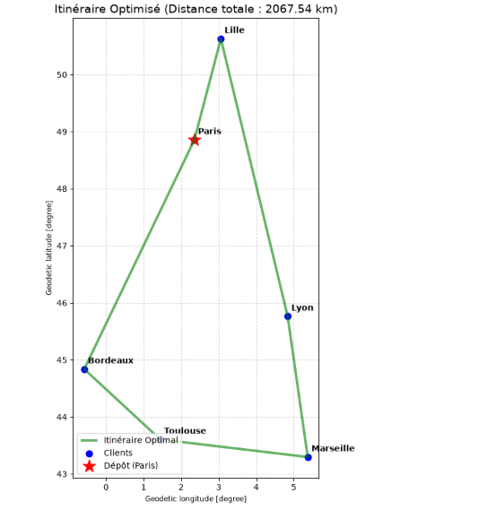
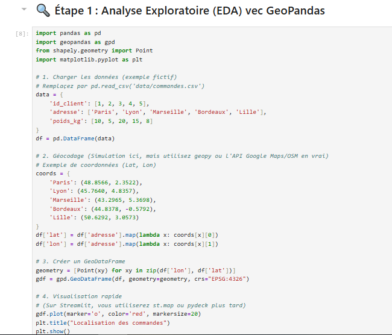
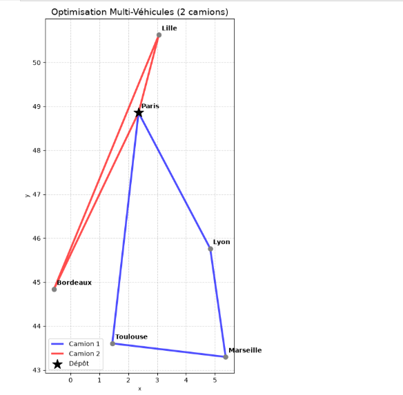
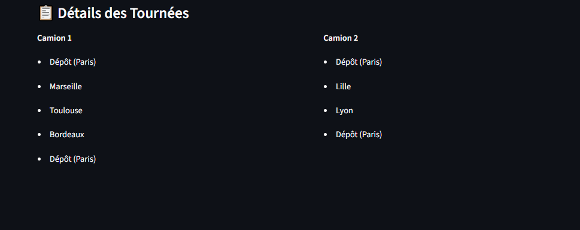
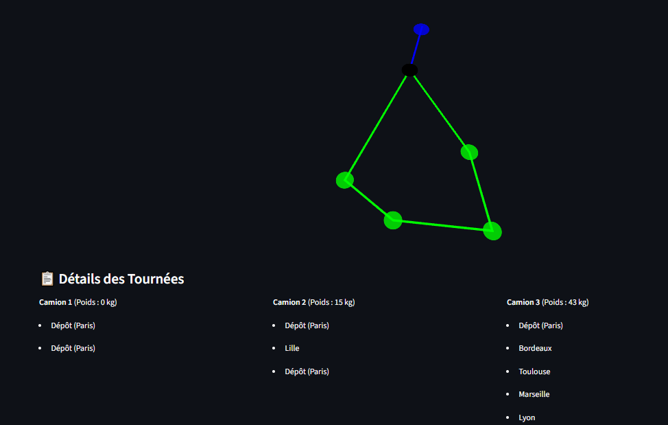

<div align="center">

# 🚚 Optimiseur de Tournées Logistiques (VRP)

**Application web d'aide à la décision pour la logistique du dernier kilomètre.**

[](https://www.python.org/)
[](https://streamlit.io/)
[](https://developers.google.com/optimization)
[](https://deckgl.readthedocs.io/)

*Optimisation mathématique • Data Science • Visualisation interactive*

</div>

---

## 📝 Description du Projet

Ce projet résout un problème classique de **Recherche Opérationnelle** : le **Vehicle Routing Problem (VRP)**. 
Il s'agit de déterminer les itinéraires optimaux pour une flotte de véhicules devant desservir un ensemble de clients géographiquement dispersés, tout en minimisant la distance totale parcourue et en respectant les **contraintes de capacité** de chaque camion.

L'application couvre l'ensemble du pipeline de la donnée : de l'exploration géospatiale (EDA) jusqu'au déploiement d'une interface web interactive (Streamlit).

---

## 📸 Aperçu de l'application

### 🗺️ Interface Utilisateur Streamlit
*Configuration dynamique de la flotte et visualisation 3D des itinéraires.*



---

### 📊 Analyse Exploratoire (EDA) & Optimisation
*Analyse de la distribution spatiale et résultats de l'algorithme.*

<p align="center">
  
  
</p>

---

### 🚛 Résultats Détaillés
*Répartition optimale des clients sur la flotte, avec respect des capacités.*

| Détail des tournées | Carte des itinéraires |
|:---:|:---:|
|  |  |

---

## ⚙️ Fonctionnalités Clés

- **🧠 Solveur Mathématique** : Utilisation de **Google OR-Tools** pour résoudre le problème du plus court chemin (TSP/VRP).
- **🚛 Multi-véhicules** : Prise en charge d'une flotte hétérogène avec des contraintes de capacité par camion (Poids en kg).
- **📍 Cartographie Interactive** : Rendu 3D fluide avec **PyDeck** (basé sur Mapbox/Deck.gl).
- **⚡ Interface Streamlit** : Paramétrage en temps réel (nombre de camions, capacité) et recalcul des tournées en un clic.
- **🛡️ Gestion d'erreurs** : Alerte si le poids total des commandes dépasse la capacité totale de la flotte configurée.

---

## 🛠️ Stack Technique

| Composant | Technologie | Rôle |
| :--- | :--- | :--- |
| **Interface** | Streamlit | Application web interactive |
| **Optimisation** | OR-Tools (Google) | Résolution du VRP (heuristique PATH_CHEAPEST_ARC) |
| **Cartographie** | PyDeck | Visualisation des trajets en 3D/2D |
| **Données** | Pandas / Numpy | Manipulation des données clients et matrices |
| **Géospatial** | GeoPandas / Shapely | Analyse spatiale et géocodage |

---

## 📂 Architecture du Projet

```text
optimisation-logistique-vrp/
│
├── commandes.csv          # Données des 50 clients (Lat, Lon, Poids, ID)
├── EDA.ipynb              # Analyse exploratoire + génération des données
├── app.py                 # Application Streamlit principale
├── requirements.txt       # Dépendances Python
├── Rapport.md             # Rapport d'analyse et méthodologie
└── README.md              # Documentation du projet
